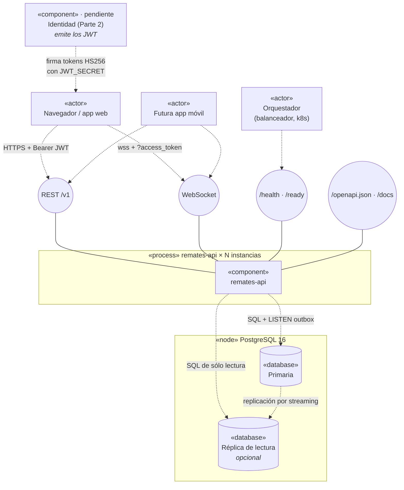
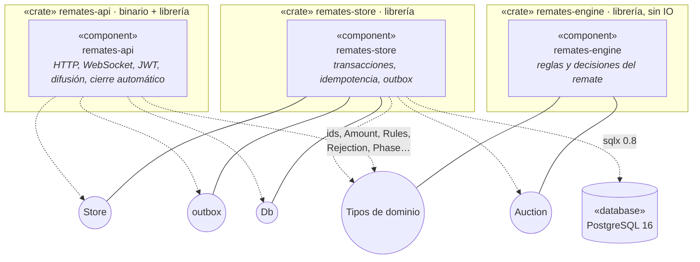
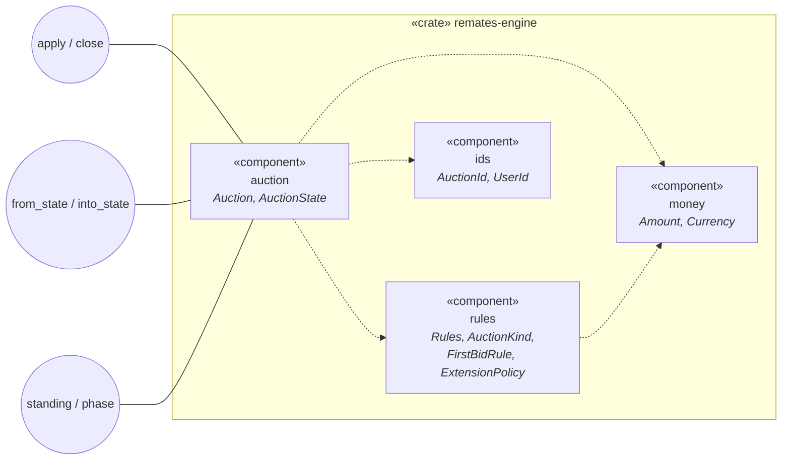
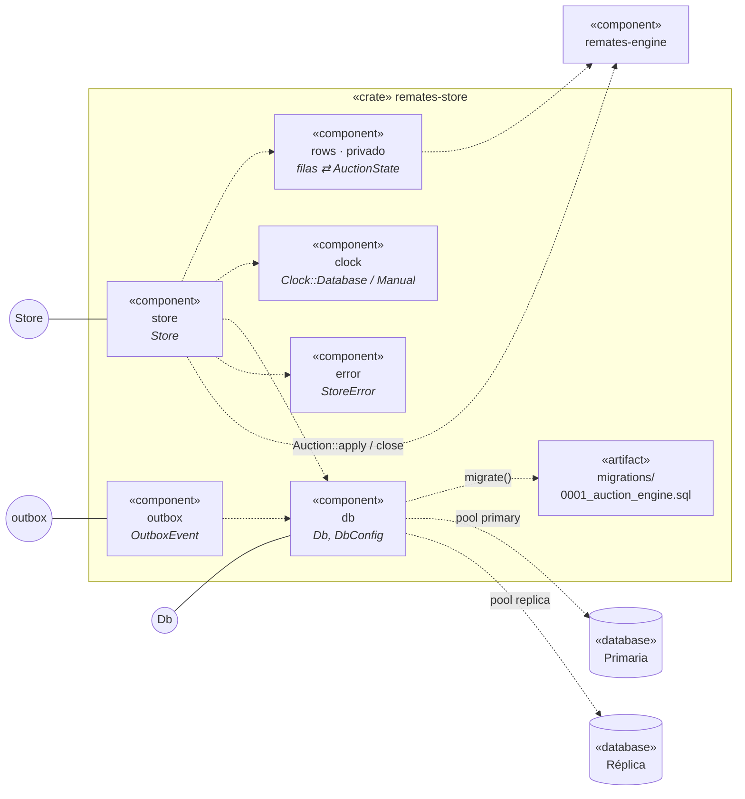
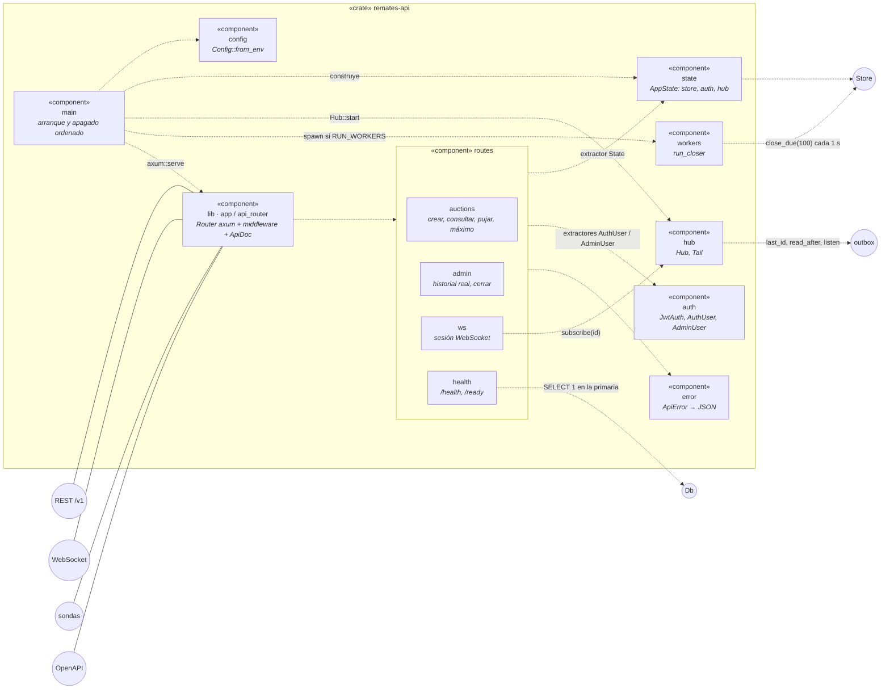
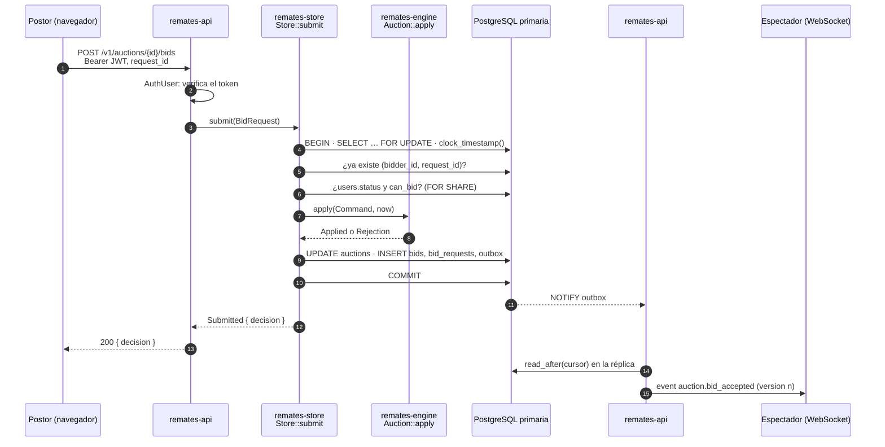
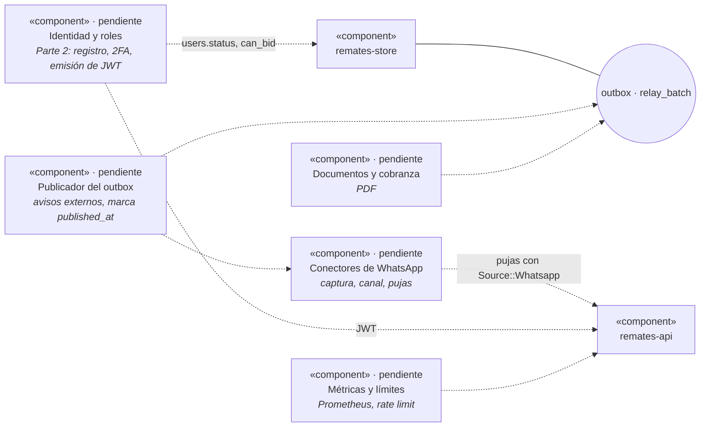

# Componentes

Diagrama UML de componentes del backend **tal como está hoy** (commit `b4f595f`): qué
componentes hay, qué interfaz ofrece cada uno, cuáles necesita y cómo se conectan.
Las decisiones y el escalado están en [`../ARCHITECTURE.md`](../ARCHITECTURE.md). Lo que todavía
no existe está en [Componentes pendientes](#componentes-pendientes).

Cómo leer los diagramas (notación UML de componentes, escrita en Mermaid):

| Elemento | Significa |
|---|---|
| Caja `«component»` | Un componente: un crate o un módulo con una responsabilidad propia. |
| Círculo `○ Nombre` | Una **interfaz ofrecida**. La línea continua la une al componente que la implementa. |
| Flecha punteada `-.->` | **Uso** de una interfaz ofrecida por otro componente (interfaz requerida). |
| Recuadro con borde | Frontera: un crate, un proceso o un nodo de despliegue. |

---

## 1. Vista de contexto

Quién habla con el backend y por dónde. Cada instancia de `remates-api` es un proceso sin
estado; puede haber N detrás de un balanceador.

Puntos clave:

- **No hay broker de mensajes.** Las instancias se coordinan por bloqueos de fila en la primaria
  y comparten eventos leyendo la misma tabla `outbox`.
- **La réplica es opcional.** Sin `DATABASE_REPLICA_URL`, el pool "réplica" apunta a la primaria.
- **Los JWT los emite otro componente** (Parte 2, todavía no construida). La API sólo los
  verifica; en pruebas usa `JwtAuth::issue`.

---

## 2. Vista de crates

Los tres crates del workspace y las interfaces que se ofrecen entre sí. Las dependencias van
en una sola dirección: `api → store → engine`. Ningún crate de abajo conoce al de arriba.

| Crate | Ofrece | Requiere | Dependencias externas principales |
|---|---|---|---|
| `remates-engine` | `Auction` (aplicar comandos, cerrar, posición, invariantes) y los tipos del dominio | Nada: ni reloj, ni base, ni red | `chrono`, `serde`, `uuid`, `thiserror`. `utoipa` sólo con la feature `openapi`. |
| `remates-store` | `Store` (operaciones del motor persistente), `outbox` (lectura y publicación de eventos), `Db` (pools) | `remates-engine`, PostgreSQL | `sqlx` (Postgres, rustls, migraciones), `serde_json` |
| `remates-api` | REST `/v1`, WebSocket por subasta, sondas, contrato OpenAPI | `remates-store`, `remates-engine` | `axum` 0.8, `tower-http`, `utoipa` 5, `jsonwebtoken`, `tokio`, `tracing` |

**Feature `openapi`.** El dominio no depende de `utoipa`. `remates-api` activa
`remates-engine/openapi` y `remates-store/openapi` para que los tipos públicos (por ejemplo
`PublicStanding` o `Rejection`) deriven su esquema y aparezcan en el contrato.

---

## 3. `remates-engine` por dentro

Dominio puro. Recibe el instante `now` como parámetro y devuelve los efectos de cada acción;
no escribe nada. Por eso se prueba con secuencias aleatorias (`tests/properties.rs`).

| Módulo | Responsabilidad | Interfaz principal |
|---|---|---|
| `auction` | Máquina de estados de una subasta: pujas manuales, máximos automáticos, alargue, cierre y adjudicación. | `Auction::new`, `apply(Command, now) -> Result<Applied, Rejection>`, `close(now) -> Result<Outcome, CloseRejection>`, `standing(now)`, `phase(now)`, `from_state` / `into_state`, `check_invariants` |
| `rules` | Configuración por subasta y su validación. Las reglas pendientes P-04 (`FirstBidRule`, `ExtensionMode`) son configurables. | `Rules::validate`, `Rules::opening_min` |
| `money` | Importes exactos en unidades menores (`i64`, nunca negativos) y monedas USD/PYG. | `Amount::try_from(i64)`, `checked_add`, `Currency::from_code` |
| `ids` | Identificadores tipados sobre `Uuid` para no mezclar subastas con usuarios. | `AuctionId`, `UserId` |

`AuctionState` es la frontera con la persistencia: `remates-store` lo arma desde las filas, el
motor lo valida al cargarlo (`from_state` llama a `check_invariants`) y lo devuelve modificado.

---

## 4. `remates-store` por dentro

Cada operación que cambia una subasta es **una** transacción en la primaria: bloquea la fila,
lee el reloj de la base, aplica el motor y escribe estado, historial, decisión y eventos juntos.

### Interfaz `Store`

| Operación | Pool | Bloqueo | Qué hace |
|---|---|---|---|
| `create_auction(NewAuction)` | primaria | — | Valida las reglas con el motor e inserta la subasta sin pujas. |
| `submit(BidRequest) -> Submitted` | primaria | `FOR UPDATE` de la subasta | Puja manual o máximo automático. Idempotente por `(bidder_id, request_id)`: un reintento devuelve la decisión guardada (`replayed = true`). Revalida `users.status` y `users.can_bid`. |
| `close_auction(id) -> Option<Closed>` | primaria | `FOR UPDATE` | Cierra si ya llegó la hora; emite el certificado secuencial (`counters`). |
| `close_due(limit) -> Vec<Closed>` | primaria | `FOR UPDATE SKIP LOCKED` | Cierra subastas vencidas. Varias instancias lo corren en paralelo sin pisarse. |
| `standing(id) -> PublicStanding` | réplica | — | Posición pública: precio, alias del líder, próxima oferta mínima, cierre. |
| `public_history(id) -> Vec<PublicBid>` | réplica | — | Historial con alias. |
| `admin_history(id) -> Vec<AdminBid>` | réplica | — | Historial con identidades reales. Sólo para administradores. |

### Interfaz `outbox`

| Función | Pool | Uso actual |
|---|---|---|
| `last_id(db)` | réplica | Punto de partida del `Hub` al arrancar. |
| `read_after(db, after, skip, limit)` | réplica | Lectura de difusión del `Hub`. No marca nada como publicado. |
| `listen(db) -> PgListener` | primaria | Despierta al `Hub` con `pg_notify('outbox')` (las notificaciones no se replican). |
| `relay_batch(db, limit, publish)` | primaria | Publicación "al menos una vez" con `SKIP LOCKED` y `published_at`. **Hoy nadie la llama**: es para el consumidor de avisos externos, que todavía no existe. |

### Eventos que escribe el `Store`

| `event_type` | Audiencia | Cuándo |
|---|---|---|
| `auction.bid_accepted` | `public` | Se aceptó una puja o un máximo que cambió la posición. Lleva alias, nunca identidades ni máximos. |
| `bid.outbid` | `user` (el postor superado) | Alguien superó al líder anterior. |
| `bid.decision` | `user` (el postor) | Siempre, aceptada o rechazada. Pensado para confirmar por el canal de origen (RF-22). |
| `auction.closed` | `public` y `admin` | Cierre, con `outcome` `awarded` o `no_sale`. |
| `auction.won` | `user` (el ganador) | Adjudicación. |
| `auction.sold` / `auction.unsold` | `user` (el vendedor) | Resultado para el vendedor. |

### Tablas (migración `0001`)

| Tabla | Rol | Mutabilidad |
|---|---|---|
| `users` | Habilitación del postor (`status`, `can_bid`). La completa la Parte 2. | Mutable |
| `auctions` | Estado de cada subasta y `last_seq`, la secuencia única de pujas entre canales. | Mutable, con bloqueo de fila |
| `auction_bidders` | Alias por subasta y máximo vigente de cada postor. | Mutable |
| `bids`, `max_bids`, `bid_requests`, `awards` | Historial, pedidos idempotentes y adjudicaciones. | **Append-only** por trigger `forbid_mutation` |
| `counters` | Numeración de certificados sin huecos. | Mutable, con bloqueo de fila |
| `outbox` | Eventos. Trigger `outbox_notify` hace `pg_notify('outbox')` en cada insert. | Se inserta; `published_at` lo marca `relay_batch` |

---

## 5. `remates-api` por dentro

Un binario (`main.rs`) que arma los componentes de la librería y los deja corriendo hasta
recibir `SIGTERM` o `Ctrl+C`. `remates-api openapi` imprime el contrato sin tocar la base.

| Componente | Responsabilidad | Notas |
|---|---|---|
| `main` | Lee la configuración, conecta los pools, aplica migraciones si `RUN_MIGRATIONS`, arranca `Hub` y `run_closer`, sirve HTTP. Al apagar cancela un `CancellationToken` compartido y espera las tareas. | Único lugar que construye dependencias concretas (`Clock::Database`, `Hub::new(256)`). |
| `config` | Variables de entorno → `Config` (bind, CORS, JWT, flags). | Delega la parte de base en `DbConfig::from_env`. |
| `lib` (`app`, `api_router`) | Registra cada ruta con `utoipa-axum`, así la ruta y su documentación salen del mismo código. Agrega `/openapi.json`, `/docs` (Scalar) y el middleware. | Middleware, de afuera hacia adentro: CORS (si hay orígenes), `x-request-id`, trazas sin query, propagación del id, timeout de 10 s; cuerpo máximo de 16 KB. |
| `state` | `AppState { store, auth, hub }`, clonado barato en cada handler. | No guarda estado de negocio. |
| `routes::auctions` | `POST /v1/auctions`, `GET /v1/auctions/{id}`, `GET`/`POST /v1/auctions/{id}/bids`, `POST /v1/auctions/{id}/max-bids`. | El postor sale del `sub` del token. El canal se indica con la cabecera `x-client-channel`. Publicar requiere rol `seller` o `admin`. Una puja rechazada responde 200. |
| `routes::admin` | `GET /v1/admin/auctions/{id}/bids`, `POST /v1/admin/auctions/{id}/close`. | Requieren `AdminUser`. |
| `routes::ws` | `GET /v1/auctions/{id}/ws`. Se suscribe al `Hub` **antes** de leer el snapshot, manda `snapshot`, después `event` filtrados por audiencia; responde a `resync`; ping cada 20 s. | De sólo lectura: las pujas siempre van por `POST`. |
| `routes::health` | `/health` (proceso vivo) y `/ready` (la primaria responde). | |
| `auth` | Verifica JWT HS256 (emisor, `exp`, `sub`, 30 s de tolerancia). Extractores `AuthUser` y `AdminUser`; `OptionalUser` en `ws`. | El rol habilita rutas; la habilitación para pujar la decide la base en `submit`. |
| `hub` | Difusión dentro de la instancia: un canal `broadcast` por subasta con suscriptores. `Tail` avanza un cursor sobre los ids del outbox tolerando huecos hasta 3 s. | Se despierta con `LISTEN outbox`; si no hay aviso, consulta cada 500 ms. Si un cliente se atrasa más de 256 eventos, recibe un snapshot nuevo. |
| `workers` | `run_closer`: llama a `close_due(100)` cada segundo. | Puede correr en todas las instancias a la vez. La exactitud del cierre no depende de este intervalo. |
| `error` | `ApiError` y su traducción a respuestas JSON (`ErrorBody { error, message }`), incluida la conversión desde `StoreError`. | 401, 403, 404, 409 y 422 son problemas del pedido, no de la subasta; 500 es un error interno. |

---

## 6. Cómo colaboran: una puja de punta a punta

Diagrama de secuencia que muestra las interfaces de las secciones anteriores en uso, con dos
instancias y un espectador conectado a la segunda.

---

## Componentes pendientes

Lo que el [SPEC](../../SPEC.md) pide y todavía no existe en el código. Se muestran para ubicar
dónde se van a enchufar.

| Pendiente | Dónde se conecta | Referencia |
|---|---|---|
| Identidad, registro, 2FA y emisión de tokens | Escribe `users`; firma los JWT que verifica `auth`. | SPEC Parte 2 |
| Publicador del outbox | Usa `outbox::relay_batch`. Hasta que exista, `published_at` queda vacío. | ARCHITECTURE, "API y tiempo real" |
| Conectores de WhatsApp | Consumen el outbox; las pujas entran por el mismo `Store::submit` con `Source::Whatsapp`. | SPEC, P-01 |
| Documentos y cobranza | Consumen `auction.closed` y `auction.won`. | SPEC |
| Métricas y límite de pedidos | Middleware en `lib::app` y contadores en `hub` y `workers`. | ARCHITECTURE, "Pendiente en esta capa" |
